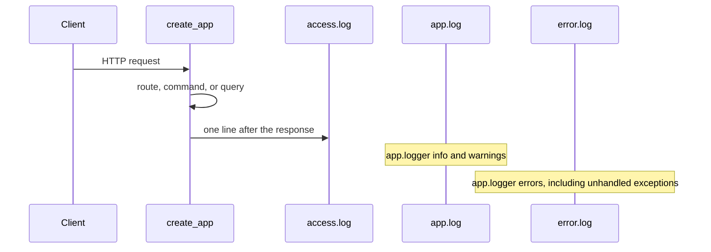

# Backend File Logging and Request Monitoring

## Recommended design

The backend has no logging configuration today. [backend/app/__init__.py](backend/app/__init__.py) only calls `app.logger.exception` for an unexpected error, and Flask sends that to the terminal. There is no log directory, no rotation, and no request log.

Use Python's standard `logging` module and `RotatingFileHandler`. No new package. The hooks live in the application factory, beside the existing error handlers. They do not go in routes, commands, queries, or domain events.

This is not a Command or a Query. It does not change volunteering state, so it does not write a `DomainEvent`. Event Sourcing stays reserved for business changes such as `UserRegistered` and `VolunteerCategoriesUpdated`.



## Log files and rotation

Directory: `backend/logs/`, created on startup. Tests pass `LOG_DIR` through the existing config override so they write under pytest's temporary folder.

Three files, which is the usual split for a small server:

- `access.log` — one line per HTTP request, including CORS preflight. Logger name `volunteerconnect.access`.
- `app.log` — application messages at INFO and above from `app.logger`.
- `error.log` — ERROR and above from `app.logger` only. An unexpected exception still uses the existing `app.logger.exception("Unhandled error")`, and that record lands here and in `app.log`.

Each file uses `RotatingFileHandler`: 1 MB per file, 5 backups, UTF-8. After `access.log` reaches 1 MB, it becomes `access.log.1`. The cap is about 6 MB per stream. Size-based rotation fits a single Flask process and does not need a midnight task. A multi-process queue is unnecessary for this project.

Access line fields, in this order:

```text
2026-10-14 08:01:02 INFO ip=127.0.0.1 origin=- method=GET path=/api/users/me status=401
```

- Timestamp from the log formatter, local time is acceptable because the handler supplies it.
- Client IP from `request.remote_addr`.
- Origin from the `Origin` header, or `-` when the header is absent.
- Method, URL path from `request.path`, and `response.status_code`.

`request.path` is the URL path without the query string, so a future token in a query string is not written. The line does not include the body, the `Authorization` header, cookies, or the JWT.

Werkzeug's built-in request printer is detached from the console. The files are the request record when the app is run with `python run.py`.

## Safety

- `after_request` writes the access line inside `try/except`. A disk or rotation failure returns the response unchanged.
- `configure_logging` also catches setup failure. If the log directory cannot be created, the API still starts.
- Loggers use `propagate = False`, so records are not copied to the terminal by the root logger.
- Handlers are replaced, not stacked, when `create_app` runs again in tests. Old file handlers are closed so Windows can delete the temporary directory.
- Passwords stay out because the access logger never reads `request.get_json()` or `request.data`. Login and profile update keep sending passwords in the body, and those bodies are not logged.

## Files

### Create

[backend/app/logging_config.py](backend/app/logging_config.py)

- `configure_logging(app)` reads `LOG_DIR`, `LOG_MAX_BYTES`, and `LOG_BACKUP_COUNT` from app config.
- Builds the directory and the three rotating handlers.
- Attaches the app and error handlers to `app.logger`.
- Returns the access logger used by the request hook.
- Closes and removes previous handlers for these loggers before adding new ones.

[backend/tests/test_request_logging.py](backend/tests/test_request_logging.py)

- Uses the test client and a temporary `LOG_DIR`.

### Modify

[backend/app/config.py](backend/app/config.py)

- `LOG_DIR` defaults to `backend/logs`.
- `LOG_MAX_BYTES` defaults to `1048576`.
- `LOG_BACKUP_COUNT` defaults to `5`.

[backend/app/__init__.py](backend/app/__init__.py)

- Call `configure_logging(app)` after config is applied and before the database startup block.
- Register `after_request` to log IP, origin, method, path, and status, then return the response.
- Leave routes, commands, and queries unchanged.
- Keep the existing unexpected-error handler. Its `app.logger.exception` call becomes the error-file record.

[backend/tests/conftest.py](backend/tests/conftest.py)

- Set `LOG_DIR` to `tmp_path / "logs"` for every test app.
- After the test, close the logging handlers so the temporary files can be removed.

[.gitignore](.gitignore)

- Ignore `backend/logs/` so log files are not committed.

[docs/requirements.md](docs/requirements.md)

- Add a short Non-functional section: the backend writes request, application, and error logs to rotating files and does not log passwords or tokens.

[docs/architecture.md](docs/architecture.md)

- Add a Logging section with the three files, the access fields, rotation limits, and the statement that request logs are not domain events.

[README.md](README.md)

- Add a short Logging note under Architecture pointing at `backend/logs/` and the three files.

[docs/features.md](docs/features.md) stays as the CLIENT and VOLUNTEER catalog. This behavior is operational, so the requirement belongs in [docs/requirements.md](docs/requirements.md) and the design belongs in [docs/architecture.md](docs/architecture.md).

## Tests

- `GET /api/users/me` without a token returns `401`, and `access.log` contains the IP, `GET`, `/api/users/me`, and `401`.
- `POST /api/auth/login` with a password in the JSON body returns an error, and neither `access.log` nor `app.log` contains that password or the word `Bearer`.
- `app.logger.error("marker")` writes `marker` to `error.log`. The same marker is not required in `access.log`.
- If the access logger raises, the request still returns its normal response.
- A tiny `LOG_MAX_BYTES` in one test produces a rotated backup file.

## Implementation steps

1. Add the logging settings to `Config`.
2. Add `configure_logging` with the three rotating file handlers and safe handler replacement.
3. Call it from `create_app` and register the guarded `after_request` hook. Detach Werkzeug's console request logger.
4. Point the test app at a temporary log directory and close handlers after each test.
5. Add the tests above.
6. Ignore `backend/logs/` and document the behavior in the requirements, architecture, and README.
7. Run the logging tests and the existing auth test module to confirm login and protected routes still behave as they do now.

Nothing will be implemented until you approve this plan.
