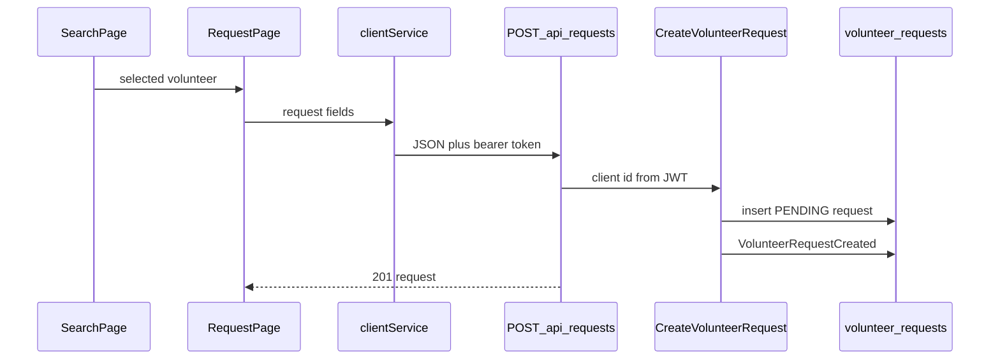

# Create Volunteering Request

## Recommended feature

**Create a volunteering request** (`POST /api/requests`, command `CreateVolunteerRequest`, event `VolunteerRequestCreated`).

Why this one, after accounting for the sections above search in [docs/features.md](docs/features.md):

- About Me text and the monthly-hours goal are already saved on the profile and About Me is already returned by search. Embedding About Me in a vector database belongs with RAG, which is later. Completed and remaining hours count only `COMPLETED` activities, and no request exists yet, so that progress cannot be calculated now.
- The volunteer dashboard and request approval are listed above search, and both need a request. Approval needs a `PENDING` request. The dashboard’s pending list, upcoming activities, and completed hours need requests too. Building those screens now would only show an empty state.
- Search is done. The next client section is Volunteer Profile, then Create Volunteering Request. Search results already show the documented public profile: name, address, categories, About Me, and availability. A separate details endpoint would repeat that list. This slice uses the search result as the volunteer the client has already viewed, and adds the request.
- `GET /api/volunteers/{volunteer_id}`, approve, reject, complete, and both dashboards stay later.

Actor: CLIENT, including a user who also has VOLUNTEER. A VOLUNTEER-only user cannot create a request.

## Business rules

The body matches [docs/api.md](docs/api.md):

- `volunteer_id` — an existing user with the VOLUNTEER role. Unknown id or a user who is not a volunteer returns `404`.
- `category` — one of the eight allowed categories, and one of the categories that volunteer has saved. Anything else returns `400`.
- `date` — `YYYY-MM-DD`.
- `start_time` — `HH:MM`.
- `duration` — a whole number of hours, at least 1. Later, only a `COMPLETED` request’s duration counts toward the monthly goal. This command does not update hours.
- `description` — required text, trimmed, 1–2000 characters.

The task location is not typed and is not chosen again. The command copies the client’s saved Google Places address onto the request:

- `location` — the client’s formatted `address`
- `google_place_id`
- `latitude`
- `longitude`
- `location_cached_at` — the same timestamp already stored on the client, so this copy does not start a new 30-day cache

No new Google request is made. If the client has no place id or no coordinates, the command returns `400` and tells them to set their profile address first. If the body includes `location`, `google_place_id`, `latitude`, or `longitude`, the command returns `400`, because those values come from the saved profile.

`client_id` comes from the JWT. If the body includes `client_id` or `status`, the command returns `400`. The stored status is always `PENDING`.

A client cannot send a request to their own user id. That returns `400`.

The command does not check that `start_time` falls inside the volunteer’s availability. Search already applied that filter when the client used it.

Success returns `201` with the saved request, including `id`, `client_id`, `volunteer_id`, the submitted fields, the copied location fields, `status: "PENDING"`, and `created_at`. Email, phone, and password are not returned.

## Classification

- **Command:** `CreateVolunteerRequest`.
- **Query:** none. The request page shows the volunteer already loaded by search.
- **Database:** new `volunteer_requests` table. `location` is the copied formatted address. The table also stores `google_place_id`, `latitude`, `longitude`, and `location_cached_at`, copied from the client. `db.create_all()` creates it. No change to `users`, categories, or availability.
- **Event:** `VolunteerRequestCreated` after a successful insert, on aggregate `VolunteerRequest`, with `request_id`, `client_id`, `volunteer_id`, `category`, `date`, `start_time`, `duration`, `location`, `google_place_id`, and `status`. No event when validation fails. The event does not include the password.

Saving follows the existing unit of work. The repository only adds the row to the session. The command then calls `flush()`, adds the event, and `commit()`. On failure it calls `rollback()` and re-raises. Those helpers stay in [backend/app/persistence/session.py](backend/app/persistence/session.py).

## Separate request page

The form is its own screen, like search. `view === "request"` renders only `RequestPage`. Each search result gets a **Request** button that stores the selected volunteer and opens that page. The page shows the volunteer’s name and categories, then the form. The task location is read-only text: the client’s saved address from `GET /api/users/me`. There is no address input and no new Places autocomplete on this page. **Back to search** returns to the search screen. The profile page does not contain the form.

## Files

### Create

[backend/app/models/volunteer_request.py](backend/app/models/volunteer_request.py)

- Table `volunteer_requests` with `id`, `client_id`, `volunteer_id`, `category`, `date`, `start_time`, `duration`, `location`, `google_place_id`, `latitude`, `longitude`, `location_cached_at`, `description`, `status`, and `created_at`.
- Both user ids are foreign keys to `users.id`. `status` is a required string. `duration` is a required integer. The place columns are required because they are copied from a client who already has a Google place.

[backend/app/persistence/request_repository.py](backend/app/persistence/request_repository.py)

- `add(request)` adds the row to the session and does not commit.

[backend/app/commands/create_volunteer_request.py](backend/app/commands/create_volunteer_request.py)

- Marshmallow schema for `volunteer_id`, `category`, `date`, `start_time`, `duration`, and `description`. Location fields are not accepted in the body.
- Role check, volunteer lookup, category check, then copy `address`, `google_place_id`, `latitude`, `longitude`, and `location_cached_at` from the authenticated client.
- Flush / event / commit sequence above.
- Returns the public request dictionary, including the copied location.

[backend/tests/test_create_volunteer_request.py](backend/tests/test_create_volunteer_request.py)

[frontend/src/pages/RequestPage.jsx](frontend/src/pages/RequestPage.jsx)

- Loads the current user with `getCurrentUser` and shows that address as the task location. The address is not an input.
- Form for category, date, start time, duration, and description.
- The category dropdown lists only that volunteer’s saved categories.
- The submit body does not include location or place fields.
- Does not call `fetch` directly and does not load the Maps script. On success it shows the new request id, `PENDING`, and the copied address. A `401` calls `onLoggedOut`.

### Modify

[backend/app/models/__init__.py](backend/app/models/__init__.py) and [backend/app/__init__.py](backend/app/__init__.py)

- Import `VolunteerRequest` so `db.create_all()` creates the table.
- Register a new requests blueprint.

[backend/app/routes/requests.py](backend/app/routes/requests.py)

- Blueprint prefix `/api/requests`.
- Thin `POST ""`: JWT id plus JSON body go to `CreateVolunteerRequest`, response `201`.
- No validation or database work in the route.

[backend/app/commands/__init__.py](backend/app/commands/__init__.py)

- Export `CreateVolunteerRequest`.

[frontend/src/services/clientService.js](frontend/src/services/clientService.js)

- Add `createVolunteerRequest(payload)` as `POST /api/requests`.

[frontend/src/pages/SearchPage.jsx](frontend/src/pages/SearchPage.jsx)

- Add a Request button on each result. It calls `onRequestVolunteer(volunteer)` and does not submit a request itself.

[frontend/src/App.jsx](frontend/src/App.jsx)

- Add the `request` view, keep the selected volunteer in state, and pass `onShowSearch` into `RequestPage`.

[docs/api.md](docs/api.md)

- Document that the task location is copied from the client’s Google place, the `201` body, `400`, `401`, `403`, and `404`.

[docs/data-model.md](docs/data-model.md)

- Add `google_place_id`, `latitude`, `longitude`, and `location_cached_at` to `volunteer_requests`.
- State that `location` and those place fields are copied from the client at creation time.

Do not add approval, rejection, completion, dashboards, the details endpoint, or vector embedding.

## Implementation steps

1. Add the `VolunteerRequest` model and repository.
2. Implement `CreateVolunteerRequest` with validation and `VolunteerRequestCreated` inside flush / commit / rollback.
3. Add the thin `POST /api/requests` route and register the model and blueprint.
4. Add tests:
   - A client creates a request for a volunteer’s saved category. The response is `201`, status is `PENDING`, `client_id` is the caller, and `location`, `google_place_id`, `latitude`, `longitude`, and `location_cached_at` match the client’s saved place. `VolunteerRequestCreated` stores that request id.
   - A VOLUNTEER-only user receives `403`. A missing token receives `401`.
   - An unknown `volunteer_id` receives `404`.
   - A category the volunteer did not select, a duration below 1, a blank description, a self-request, a client with no saved place, or a body that includes `client_id`, `status`, or `location` returns `400` and writes no row and no event.
5. Add the request page and the search-result button that opens it.
6. Document the copied location in [docs/api.md](docs/api.md) and [docs/data-model.md](docs/data-model.md).
7. Run the request tests. Then verify in the browser: search as a client, open Request for one volunteer, confirm the form shows the client’s saved address and has no address field, submit a valid request, see `PENDING` with that address, and confirm a volunteer-only account cannot open that flow from search.

Nothing will be implemented until you approve this plan.
