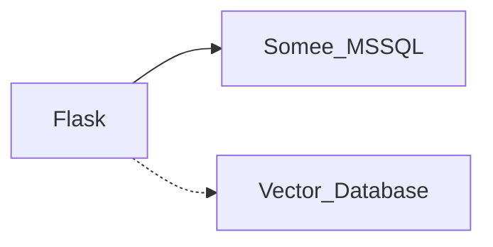
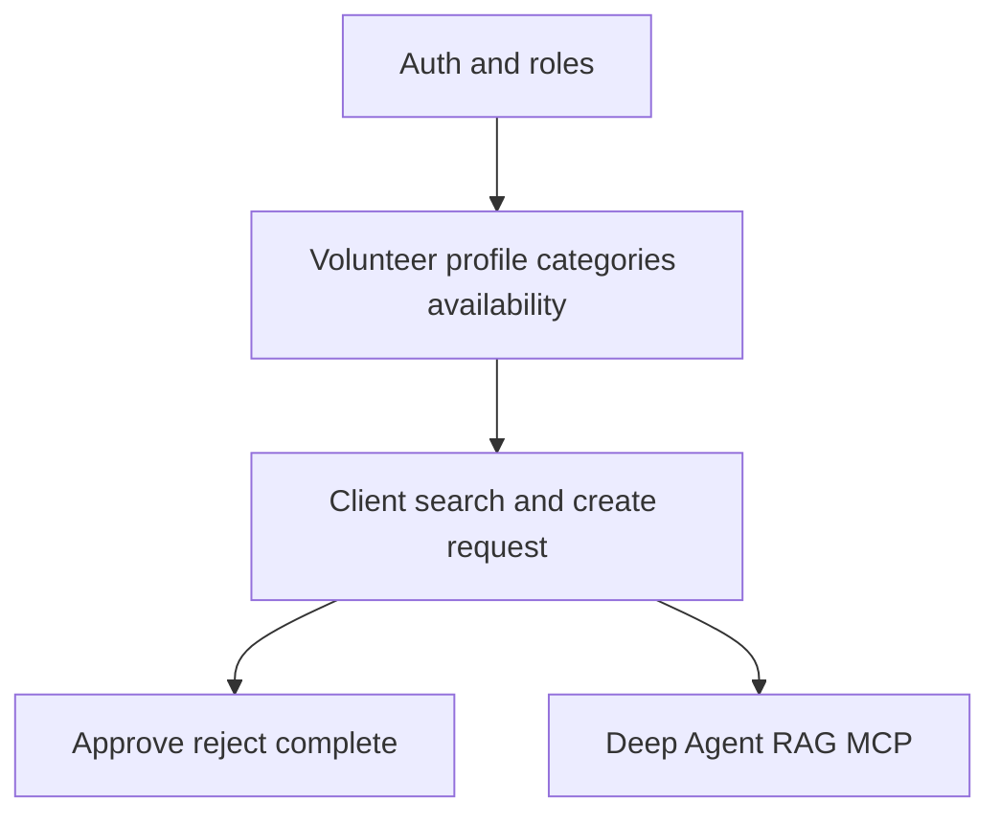

# First Feature: User Registration and Authentication

## Database decision (confirmed)

- **Operational relational database:** existing Somee **MS SQL Server** (`VolunteerConnect.mssql.somee.com`). All application tables (`users`, `domain_events`, and later requests/availability/etc.) live here.
- **Vector Database / RAG:** unchanged. Keep the existing documented choice (PostgreSQL with pgvector or another compatible vector database, stored separately). Do not connect to it or create vector tables in this feature.

SQLAlchemy will talk to SQL Server via an env-based connection string. Do not commit secrets from [backend/.env](backend/.env). Add a `.env.example` with placeholder keys only.



Solid line now: Flask to Somee. Dashed line later: vector DB / RAG, as already documented.

## Step 1 — Documentation updates (minimal, targeted)

Do not rewrite files. Change only the sentences that currently imply PostgreSQL is the **operational** database. Do **not** edit Vector Search / Vector Database sections.

### [README.md](README.md) — Technology Stack → Database only

Replace:

```text
### Database

- PostgreSQL
- Cloud-hosted database (Somee.com)
```

with:

```text
### Database

- Microsoft SQL Server
- Cloud-hosted operational database (Somee.com)
```

Leave the **Vector Search** subsection exactly as it is (`PostgreSQL with pgvector or another compatible vector database`). Leave the Deep Agent workflow and “Flask saves the request in the cloud-hosted database (Somee.com)” wording in place.

### [docs/architecture.md](docs/architecture.md)

- Overview bullet: `Relational Database: PostgreSQL hosted in the cloud` → `Relational Database: Microsoft SQL Server hosted on Somee.com`
- `# Relational Database`: keep Somee.com; add that it is **MS SQL Server**
- Do not change the Vector Database overview bullet, diagram labels, or `# Vector Database` section

### [docs/data-model.md](docs/data-model.md) — Current Hosting Decision

Add that the Somee.com operational database is **MS SQL Server**. Leave the existing vector-database hosting paragraphs unchanged (separate store; exact vector implementation may change).

### [.cursor/rules/project-architecture.mdc](.cursor/rules/project-architecture.mdc)

Replace `PostgreSQL is the relational database.` with: Somee MS SQL Server is the operational relational database. Do not change the RAG / Vector Database rule.

Do **not** change [docs/requirements.md](docs/requirements.md), [docs/features.md](docs/features.md), [docs/api.md](docs/api.md), or [docs/testing.md](docs/testing.md); they do not name PostgreSQL as the operational store.

## Feature to implement after the docs

Implement **user registration, login, and logout**, including role selection (`CLIENT`, `VOLUNTEER`, or both) on a single account.

This is listed first in [docs/requirements.md](docs/requirements.md), [docs/features.md](docs/features.md), [docs/api.md](docs/api.md), [docs/testing.md](docs/testing.md), and the README main-features list.

Do **not** start with volunteer search, requests, dashboards, RAG, MCP tools, or the Deep Agent.



## Feature scope (keep it small)

Actors: both CLIENT and VOLUNTEER.

**In scope**
- Register with name, email, password, phone, address, and `roles: ["CLIENT"]` / `["VOLUNTEER"]` / both (`POST /api/auth/register`)
- Login (`POST /api/auth/login`) and logout (`POST /api/auth/logout`)
- Get current user (`GET /api/users/me`)
- Hash passwords; never store or return the raw password
- Record `UserRegistered` as a domain event
- Minimal React register/login screens that call an API service (not the component)
- Persist only to Somee MS SQL Server

**Out of scope**
- Volunteer categories, availability, About Me, monthly goal
- Volunteer search and volunteering requests
- Dashboards
- RAG, vector DB, Deep Agent, MCP, Tavily
- Any vector-database connection or schema changes

## CQRS and persistence

- **Command:** `RegisterUser` (writes user + `UserRegistered` event to SQL Server)
- **Session:** login/logout using Flask-JWT-Extended (simplest option allowed by the API doc)
- **Query:** `GetUserProfile` for `/api/users/me`
- **Tables:** `users` and `domain_events` only, as defined in [docs/data-model.md](docs/data-model.md)
- **Event:** `UserRegistered`
- **Access:** Flask-SQLAlchemy (or equivalent) against Somee; no DB access inside route functions

Thin Flask routes; business logic in command/query handlers.

## Tests required by the docs

From [docs/testing.md](docs/testing.md):

- Register valid user
- Reject duplicate email
- Login with valid credentials
- Reject invalid credentials
- Protected endpoint without authentication returns 401
- `RegisterUser` validates input, persists the user, and writes `UserRegistered`

Do not require the vector database for these tests.
