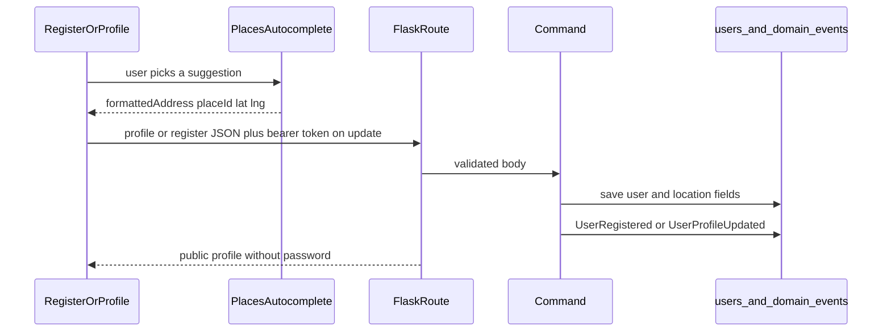

# Update User Profile

## Recommended feature

**Update User Profile** stays the next feature (`PUT /api/users/me`, command `UpdateUserProfile`, event `UserProfileUpdated`). Registration, login, logout, and read-only `GET /api/users/me` already exist. [docs/features.md](docs/features.md) and [docs/data-model.md](docs/data-model.md) now expand that profile slice, so this plan replaces the earlier “name, phone, and address only” version.

Actors: any authenticated user (CLIENT, VOLUNTEER, or both). Registration is included only for the address rule, because a new account must select a place the same way.

## What changed in the docs

From [docs/features.md](docs/features.md) User Profile:

- Every profile update requires the current password first.
- Editable fields are name, phone, address, and roles.
- Password change is part of this profile area: new password, confirmation, current-password check, and the existing password rules. The plain password is never stored or returned.
- Registration and profile update must use Google Maps Places Autocomplete. The user must pick a suggestion. Editing the text after a selection invalidates it until they pick again.
- Volunteer-only fields in the same section remain About Me and monthly hours goal. Categories and availability stay separate features.

From [docs/data-model.md](docs/data-model.md) User:

- Persist `address`, `google_place_id`, `latitude`, and `longitude`.
- A new address must update those location fields together.
- Location belongs to the user and is shared by both roles.
- Location changes are recorded in event sourcing.
- Place IDs may be stored permanently. Address text and coordinates must follow Google Maps Platform caching rules.

[docs/api.md](docs/api.md) still shows the old update body. That document will be updated during implementation so it matches this behavior.

## Business rules

Profile update body:

- `current_password` is required for every update. If it does not match the stored hash, return `401`, change nothing, and write no event.
- `name` and `phone` use the same limits as registration (trimmed, non-blank; name 1–255, phone 1–50).
- `roles` uses the same rule as registration: one or both of `CLIENT` and `VOLUNTEER`. An empty list is `400`.
- Email stays read-only. Sending `email` is `400`.
- `new_password` and `confirm_password` are optional together. If either is sent, both are required, they must match, and the new password must be at least 8 characters and not only whitespace. On success, store only `password_hash`. Omit both to leave the password unchanged.
- `about_me` and `monthly_hours_goal` are accepted only when the saved roles include `VOLUNTEER`. A user without that role who sends either field gets `403`. `monthly_hours_goal` is an integer of at least 1, or JSON `null` to clear it. An empty `about_me` clears it to null.
- The user id comes from the JWT, not the body.

Address, on both register and update:

- The client sends `address` (formatted address), `google_place_id`, `latitude`, and `longitude` together.
- Missing any of the four, a blank place id, latitude outside -90..90, or longitude outside -180..180 returns `400`.
- Free text with no place selection is rejected.
- If the profile address is unchanged, resend the stored place id and coordinates. No new Google request is required.
- A legacy account whose address has no place id must select a suggestion before the profile can be saved.

Password and place id never appear in API responses or event payloads. The event may include `password_changed: true/false`.

## Google Maps: configuration, cost, and storage

The browser key is already `VITE_GOOGLE_MAPS_API_KEY` in the frontend environment ([frontend/.env.example](frontend/.env.example)). `.env` is gitignored. Do not add a backend Maps key and do not call Google from Flask or from tests.

Configuration to confirm in Google Cloud before browser testing, not in application code:

- Restrict the key by HTTP referrer to the Vite origin (`http://localhost:5173/*`) and any later deployed origin.
- Restrict the key to the Maps JavaScript API and Places API.
- Set a budget alert. The key is visible in the browser, so referrer and API restrictions are what keep it from being reused elsewhere.

Cost control in the UI:

- Load the Maps JavaScript API only on the register and profile screens.
- Use the Places Autocomplete widget with its built-in session, and read only `id`, `formattedAddress`, and `location` after selection.
- Do not request photos, reviews, phone numbers, or opening hours. Those fields move the request to a higher Places SKU.
- An abandoned autocomplete session is billed per request. Selecting a suggestion ends the session at Place Details Essentials, which is the cheap path for this form.
- Google’s current Places terms (section 14.3) allow latitude and longitude to be cached for 30 consecutive calendar days, after which they must be deleted. Place IDs may be stored indefinitely. Place IDs older than 12 months should be refreshed later; that refresh is not part of this feature.
- Do not draw these coordinates on a non-Google map. Places content may not be used with a non-Google map. Showing the formatted address as text is fine. The future `check_location_distance` tool can compute distance from coordinates without rendering a map.

Storage decision, which will be written into [docs/data-model.md](docs/data-model.md) when this is implemented:

- `google_place_id` is stored permanently.
- `address` is the formatted address the user confirmed for that account. It is not a shared geocoding cache.
- `latitude` and `longitude` are stored with `location_cached_at`. That timestamp is the compliance field the data model does not name yet. A later distance feature must treat coordinates older than 30 days as expired and refresh them with Place Details using the stored Place ID. This feature only records the timestamp; it does not build the refresh job or the MCP tool.

## Classification

- **Command:** `UpdateUserProfile`. Also extend the existing `RegisterUser` command so a new account cannot save a free-text address.
- **Query:** extend `GetUserProfile` so the owner sees `address`, `google_place_id`, `latitude`, and `longitude`. It still does not return the password. No new query class.
- **Database:** add columns on `users`. Tests build a fresh SQLite schema. The Somee `users` table already exists, and `db.create_all()` will not add columns, so startup needs an idempotent add for the new columns on both SQLite and SQL Server.
- **Events:** `UserProfileUpdated` after a successful update, including the location fields and `password_changed`, never the password. Extend `UserRegistered` with the place id and coordinates, still without the password. No event when validation or the current-password check fails.

## Files

Create:

- [backend/app/commands/update_user_profile.py](backend/app/commands/update_user_profile.py) — schema, current-password check, password hashing, role and volunteer-field rules, location validation, persist, event.
- [backend/tests/test_update_profile.py](backend/tests/test_update_profile.py) — API tests using fixture place data, no Google calls.
- [frontend/src/services/googlePlaces.js](frontend/src/services/googlePlaces.js) — load the Maps script from `VITE_GOOGLE_MAPS_API_KEY`.
- [frontend/src/components/AddressAutocomplete.jsx](frontend/src/components/AddressAutocomplete.jsx) — suggestion control used by both forms. If the text changes after a selection, clear the place id and coordinates.

Modify:

- [backend/app/models/user.py](backend/app/models/user.py) — `google_place_id`, `latitude`, `longitude`, `location_cached_at`.
- A small idempotent column-add used from [backend/app/__init__.py](backend/app/__init__.py), so the existing Somee table gains the new columns.
- [backend/app/commands/register_user.py](backend/app/commands/register_user.py) — require the four location fields and store them. Update its event payload.
- [backend/app/queries/get_user_profile.py](backend/app/queries/get_user_profile.py) — return the location fields to the owner.
- [backend/app/routes/users.py](backend/app/routes/users.py) — thin `PUT /me`.
- [backend/app/errors.py](backend/app/errors.py) — `ForbiddenError` with status `403`.
- [backend/app/commands/__init__.py](backend/app/commands/__init__.py) — export `UpdateUserProfile`.
- [backend/tests/test_auth.py](backend/tests/test_auth.py) and [backend/tests/test_register_user.py](backend/tests/test_register_user.py) — registration payloads include fixture place fields, and a case rejects an address with no place id.
- [frontend/src/services/authService.js](frontend/src/services/authService.js) — `updateCurrentUser`.
- [frontend/src/pages/RegisterPage.jsx](frontend/src/pages/RegisterPage.jsx) and [frontend/src/pages/ProfilePage.jsx](frontend/src/pages/ProfilePage.jsx) — shared address control. Profile form edits name, phone, roles, address, and optional new password, and always asks for the current password. Email stays read-only. About Me and monthly goal render only when Volunteer is selected.
- [docs/api.md](docs/api.md) — register and update request bodies, current-password failure, and location validation.
- [docs/data-model.md](docs/data-model.md) — record `location_cached_at` and the 30-day coordinate rule.

Do not implement categories, availability, search, requests, dashboards, or `check_location_distance`.

## Implementation steps

1. Add the location columns to the User model and an idempotent column add for databases that already have `users`.
2. Extend `RegisterUser` and `GetUserProfile` for the location fields. Reject registration that has an address without a place id and coordinates.
3. Add `ForbiddenError`.
4. Implement `UpdateUserProfile` in the same style as [backend/app/commands/register_user.py](backend/app/commands/register_user.py): Marshmallow schema, `UserRepository`, `EventRepository`, `flush` / `commit` / `rollback`. Verify `current_password` with the existing hash checker before any write. Hash `new_password` only when a matching confirmation is provided. Set `location_cached_at` whenever coordinates are saved. Write `UserProfileUpdated` and commit.
5. Add thin `PUT /api/users/me`.
6. Add tests that never call Google:
   - Update name, phone, roles, and a fixture place; response matches stored values; `UserProfileUpdated` is stored; password hash is unchanged when no new password is sent.
   - Wrong current password returns `401` and leaves the row and events unchanged.
   - Missing current password returns `400`.
   - New password plus a different confirmation returns `400`. A matching new password of at least 8 characters updates only the hash, and login works with the new password.
   - Address without place id or coordinates returns `400`.
   - CLIENT who sends `about_me` or `monthly_hours_goal` gets `403`.
   - Missing token returns `401`.
   - Registration without place fields returns `400`; registration with fixture place fields stores them.
7. Add the Places loader and autocomplete control. Register and profile cannot submit until a suggestion is selected. Changing the text clears the selection. If the env key is missing, the form shows a clear error.
8. Update [docs/api.md](docs/api.md) and the storage note in [docs/data-model.md](docs/data-model.md).
9. Run the backend tests. Then verify in the browser: register by picking a suggestion, log in, change name, phone, and password with the current password, confirm the old password no longer logs in, change the address by picking a new suggestion, and confirm typed-only address text cannot be saved.

Nothing will be implemented until you approve this plan.
