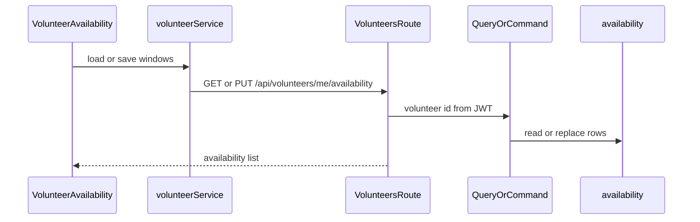

# Volunteer Availability

## Recommended feature

**Define recurring availability** (`GET` and `PUT /api/volunteers/me/availability`).

Why this one:

- Already implemented: register, login, logout, profile view and update, and volunteer categories.
- [docs/features.md](docs/features.md), [docs/api.md](docs/api.md), and [docs/data-model.md](docs/data-model.md) place availability immediately after categories. About Me and the monthly hours goal are already saved with the profile.
- Search and AI matching use availability later. Those features need these rows to exist first.
- The role table allows only a VOLUNTEER to set availability. A user who also has CLIENT may set it. A CLIENT-only user may not.

## Business rules

Each window has `day_of_week`, `start_time`, and `end_time`, matching the API example and the data-model row:

- `day_of_week` is one of `SUNDAY`, `MONDAY`, `TUESDAY`, `WEDNESDAY`, `THURSDAY`, `FRIDAY`, `SATURDAY`. The week starts on Sunday, so that is the stored order and the order shown in the day select.
- Times use `HH:MM` on a 24-hour clock, as in `09:00` and `13:00`.
- `end_time` must be later than `start_time` on that same day. The documented examples are same-day ranges, and the table has no second day.

`PUT` replaces the volunteer's whole set, the same rule already documented for categories. An empty `availability` array clears it. The docs do not require at least one window.

Windows for one volunteer must not overlap. Two windows on the same day overlap when each starts before the other ends. That includes an exact duplicate. Overlap returns `400` and leaves the previous rows unchanged. Windows on different days do not overlap. A window that ends at the same minute the next one starts, such as `09:00–13:00` and `13:00–16:00`, does not overlap and is allowed. Two different non-overlapping windows on the same day are allowed.

Both endpoints require a valid bearer token (`401` otherwise) and the VOLUNTEER role (`403` otherwise). The volunteer id comes from the JWT. This is not a profile update, so the current password is not required.

Both GET and PUT return:

```json
{
  "availability": [
    {
      "day_of_week": "MONDAY",
      "start_time": "09:00",
      "end_time": "13:00"
    }
  ]
}
```

Rows are ordered Sunday through Saturday, then by start time. The database `id` is not returned.



## Classification

- **Query:** `GetVolunteerAvailability` — reads windows and writes nothing.
- **Command:** `UpdateVolunteerAvailability` — replaces that volunteer's windows.
- **Database:** new `availability` table with `id`, `volunteer_id`, `day_of_week`, `start_time`, and `end_time`. `volunteer_id` references `users.id`. `db.create_all()` creates the new table. No change to `users` or `volunteer_categories`.
- **Event:** `VolunteerAvailabilityUpdated` on aggregate `User` after a successful replace, with `volunteer_id` and the new windows. No event on GET, validation failure, or `403`.

## Why the existing frontend service is extended

Availability calls stay in [frontend/src/services/volunteerService.js](frontend/src/services/volunteerService.js), which already calls the category endpoints through `apiRequest`. The new component only edits the list of windows. No new backend service class is added. The rules stay in the query and the command.

## Files

### Create

[backend/app/models/availability.py](backend/app/models/availability.py)

- SQLAlchemy model `Availability`, table `availability`.
- `id` integer primary key.
- `volunteer_id` integer, foreign key to `users.id`, not null.
- `day_of_week` string, not null.
- `start_time` and `end_time` as time columns, not null.

[backend/app/persistence/availability_repository.py](backend/app/persistence/availability_repository.py)

- `list_for_volunteer(volunteer_id)` returns windows ordered Sunday through Saturday, then by start time.
- `replace_for_volunteer(volunteer_id, windows)` deletes that user's current rows and inserts the new ones. It only adds work to the current session. It does not call `flush`, `commit`, or `rollback`.

[backend/app/queries/get_volunteer_availability.py](backend/app/queries/get_volunteer_availability.py)

- `GetVolunteerAvailability.execute(user_id)`.
- Missing user raises `NotFoundError`. A user without `VOLUNTEER` raises `ForbiddenError`.
- Returns `{"availability": [...]}` and does not commit.

[backend/app/commands/update_volunteer_availability.py](backend/app/commands/update_volunteer_availability.py)

- `UpdateVolunteerAvailability.execute(user_id, data)`, following [backend/app/commands/update_volunteer_categories.py](backend/app/commands/update_volunteer_categories.py).
- Marshmallow requires `availability` as a list of objects with `day_of_week`, `start_time`, and `end_time`.
- Rejects a bad day, a bad time, an end that is not after the start, or any overlap with `ValidationError` (`400`). An empty list is valid. Overlap is checked in this command before any delete, so a rejected request never reaches the repository.
- Role check happens before any delete.
- Saving uses the helpers in [backend/app/persistence/session.py](backend/app/persistence/session.py), the same sequence as [backend/app/commands/update_volunteer_categories.py](backend/app/commands/update_volunteer_categories.py):

```text
try:
    replace the volunteer's windows
    flush()
    add VolunteerAvailabilityUpdated
    commit()
except Exception:
    rollback()
    raise
```

- `flush()` sends the new rows to the database inside the open transaction and gives them ids before the event is added. `commit()` makes the windows and the event durable together. `rollback()` undoes both if the event insert or the commit fails. The route does not call these helpers.

[backend/app/routes](backend/app/routes/volunteers.py) stays the existing volunteers blueprint. The new view functions are added there rather than in a second blueprint.

[backend/tests/test_volunteer_availability.py](backend/tests/test_volunteer_availability.py)

- Uses the existing `client` fixture and the register/login style from [backend/tests/test_volunteer_categories.py](backend/tests/test_volunteer_categories.py).

[frontend/src/components/VolunteerAvailability.jsx](frontend/src/components/VolunteerAvailability.jsx)

- Loads windows on mount, lets the volunteer add or remove rows, and saves the current list.
- Each row has a day select, Sunday first, and two time inputs.
- Does not call `fetch` or read the token. A `401` from a revoked token uses the `onLoggedOut` prop, as the category component does.

### Modify

[backend/app/routes/volunteers.py](backend/app/routes/volunteers.py)

- Add thin `GET /me/availability` and `PUT /me/availability` beside the category routes.
- Each function reads the JWT id, calls the query or command, and returns JSON `200`.
- No role checks, time checks, or database calls in the route.

[backend/app/models/__init__.py](backend/app/models/__init__.py) and [backend/app/__init__.py](backend/app/__init__.py)

- Import `Availability` so `db.create_all()` creates the table. No new column migration.

[backend/app/commands/__init__.py](backend/app/commands/__init__.py) and [backend/app/queries/__init__.py](backend/app/queries/__init__.py)

- Export `UpdateVolunteerAvailability` and `GetVolunteerAvailability`.

[frontend/src/services/volunteerService.js](frontend/src/services/volunteerService.js)

- Add `getMyAvailability()` for `GET /api/volunteers/me/availability`.
- Add `updateMyAvailability(availability)` for `PUT` with body `{ availability }`.
- Leave the category functions unchanged.

[frontend/src/pages/ProfilePage.jsx](frontend/src/pages/ProfilePage.jsx)

- Render `VolunteerAvailability` next to `VolunteerCategories` when `form.isVolunteer` is true.
- Pass `canLoad={savedVolunteer}` and `onLoggedOut`, using the same condition the category section already uses.
- Do not add availability fields to the profile form or to `PUT /api/users/me`.

[docs/api.md](docs/api.md)

- Under Volunteer Availability, document Sunday-first weekday order, `HH:MM`, end-after-start, overlap `400`, touching windows allowed, empty array clears, the response shape, `401`, and `403`.

Do not add search, requests, dashboards, or distance checks.

## Implementation steps

1. Add the `Availability` model and repository. Replace deletes that volunteer's rows and inserts the new windows on the current session. The repository does not flush or commit.
2. Implement `GetVolunteerAvailability` and `UpdateVolunteerAvailability`. Check the user, the VOLUNTEER role, and overlap before any write. Inside `try`, replace the rows, `flush()`, add `VolunteerAvailabilityUpdated`, then `commit()`. On any exception, `rollback()` and re-raise.
3. Add the two thin routes on the existing volunteers blueprint and register the model.
4. Add tests:
   - A volunteer gets an empty list, saves Sunday `09:00–12:00` and Monday `09:00–13:00`, and reads Sunday first.
   - A second save replaces the first set, and `VolunteerAvailabilityUpdated` stores the new windows for that user id.
   - An empty array clears the rows and still records the event.
   - A bad day, a bad time, an end time that is not later than the start, an exact duplicate, or overlapping windows such as Monday `09:00–13:00` and Monday `12:00–15:00` return `400` and leave the previous rows and events unchanged.
   - Monday `09:00–13:00` and Monday `13:00–16:00` are saved.
   - A CLIENT-only user receives `403` on both GET and PUT.
   - A missing token returns `401`.
5. Extend `volunteerService.js` and add the availability editor on the profile page for volunteers. A client profile does not show it.
6. Document the rules in [docs/api.md](docs/api.md).
7. Run the availability tests. Then verify in the browser: log in as a volunteer, save Sunday and Monday windows, reload and see Sunday first, confirm an overlapping pair shows the error and is not saved, clear the list, and confirm a client account does not show the section.

Nothing will be implemented until you approve this plan.
