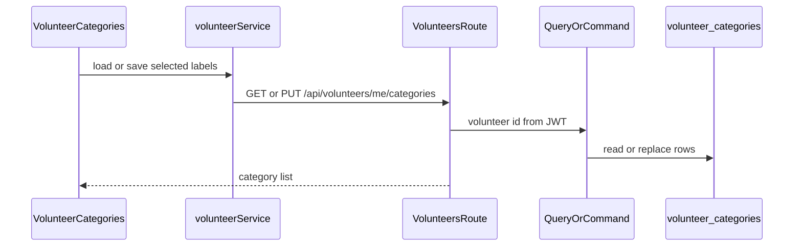

# Volunteer Categories

## Recommended feature

**Select volunteering categories** (`GET` and `PUT /api/volunteers/me/categories`).

Why this one:

- Already implemented: register, login, logout, view profile, and update profile (name, phone, password, address with Google Places, roles, About Me, and monthly hours goal).
- [docs/requirements.md](docs/requirements.md), [docs/features.md](docs/features.md), [docs/api.md](docs/api.md), and [docs/data-model.md](docs/data-model.md) all place category selection immediately after the profile. Availability, search, requests, dashboards, and AI matching come after it.
- Search will later filter on category, so the category list has to exist first.
- About Me and the monthly goal are already saved by `UpdateUserProfile`. They are not a separate feature.

Actor: a user with the VOLUNTEER role, including a user who also has CLIENT. A CLIENT-only user cannot read or change categories.

## Business rules

Allowed categories. The first six come from [docs/data-model.md](docs/data-model.md). Cooking and Cleaning are added to that catalog:

- Elderly Assistance
- Transportation
- Shopping
- Tutoring
- Technical Help
- Childcare Support
- Cooking
- Cleaning

Any other value, including a blank string, returns `400`. Duplicates in one request return `400`.

`PUT` replaces the volunteer's whole selection. An empty `categories` array is valid and clears the selection. The docs do not require at least one category.

Both endpoints require a valid bearer token (`401` otherwise) and the VOLUNTEER role (`403` otherwise). The volunteer id comes from the JWT.

This is not a profile update, so the current password is not required.

## Classification

- **Query:** `GetVolunteerCategories` — reads the current selection and writes nothing.
- **Command:** `UpdateVolunteerCategories` — replaces that volunteer's rows.
- **Database:** new `volunteer_categories` table with `volunteer_id` and `category`. `volunteer_id` references `users.id`. The pair is the primary key, matching the data model. `db.create_all()` creates the new table; no change to existing `users` columns.
- **Event:** `VolunteerCategoriesUpdated` on aggregate `User` after a successful replace, with `volunteer_id` and the new category list. No event on `GET`, validation failure, or `403`.

## Why a frontend service is needed

[frontend/src/services/volunteerService.js](frontend/src/services/volunteerService.js) is a frontend API module, the same role [frontend/src/services/authService.js](frontend/src/services/authService.js) already has for register, login, logout, and profile. The project rule is that API communication stays out of UI components.

The category checkboxes need two calls: `GET /api/volunteers/me/categories` on load and `PUT /api/volunteers/me/categories` on save. Those calls belong in `volunteerService.js`, which uses the existing `apiRequest` helper in [frontend/src/services/api.js](frontend/src/services/api.js). That helper already attaches the bearer token and turns a non-OK response into an error with `status`. The component then only deals with the selected labels, the loading state, and the error text.

No new backend service class is added. Login uses [backend/app/services/auth_service.py](backend/app/services/auth_service.py) because it is not a state-changing command. Category reads and writes are a query and a command. Putting that logic in another backend service would duplicate the CQRS handlers.

## Files

### Create

[backend/app/models/volunteer_category.py](backend/app/models/volunteer_category.py)

- SQLAlchemy model `VolunteerCategory`, table `volunteer_categories`.
- Columns: `volunteer_id` (integer, foreign key to `users.id`, not null) and `category` (string, not null).
- Composite primary key of those two columns, as in the data model. No separate `id` column.
- No relationship helpers beyond what the repository needs to insert and delete rows.

[backend/app/persistence/category_repository.py](backend/app/persistence/category_repository.py)

- `list_for_volunteer(volunteer_id)` returns the stored category strings for that user, in a stable order.
- `replace_for_volunteer(volunteer_id, categories)` deletes that user's current rows and inserts one row per category. It does not commit. The command commits, matching `UserRepository.add`, which also only adds to the session.
- No validation and no event writes here.

[backend/app/queries/get_volunteer_categories.py](backend/app/queries/get_volunteer_categories.py)

- Class `GetVolunteerCategories` with `execute(user_id)`.
- Loads the user through `UserRepository`. Missing user raises the existing `NotFoundError`.
- A user whose roles do not include `VOLUNTEER` raises the existing `ForbiddenError`.
- Returns `{"categories": [...]}`. Does not add, delete, or commit anything.

[backend/app/commands/update_volunteer_categories.py](backend/app/commands/update_volunteer_categories.py)

- Class `UpdateVolunteerCategories` with `execute(user_id, data)`, following [backend/app/commands/update_user_profile.py](backend/app/commands/update_user_profile.py): Marshmallow schema, repository, `EventRepository`, then `flush` / `commit` / `rollback`.
- Schema requires `categories` as a list of strings. Trim each value. Reject an unknown category or a duplicate with `ValidationError` (`400`). An empty list is valid.
- Same user and role checks as the query, before any delete.
- Calls `replace_for_volunteer`, then appends `DomainEvent` with `aggregate_type="User"`, `aggregate_id` set to the volunteer id, `event_type="VolunteerCategoriesUpdated"`, and JSON `event_data` of `volunteer_id` plus the new category list.
- Returns the same `{"categories": [...]}` shape as the query.
- On failure after a flush, roll back so a rejected request cannot leave a partial replacement or an event.

[backend/app/routes/volunteers.py](backend/app/routes/volunteers.py)

- Blueprint `volunteers_bp` with prefix `/api/volunteers`.
- `GET /me/categories`: `@jwt_required()`, call `GetVolunteerCategories().execute(int(get_jwt_identity()))`, return JSON `200`.
- `PUT /me/categories`: `@jwt_required()`, pass `request.get_json(silent=True) or {}` to `UpdateVolunteerCategories().execute`, return JSON `200`.
- The route functions do not check roles, validate category names, or touch the database.

[backend/tests/test_volunteer_categories.py](backend/tests/test_volunteer_categories.py)

- Uses the existing `client` fixture and the same register/login helpers style as [backend/tests/test_auth.py](backend/tests/test_auth.py).
- Covers the cases listed in the implementation steps below. Asserts status codes, response JSON, rows in `volunteer_categories`, and whether a `VolunteerCategoriesUpdated` row was or was not inserted.

[frontend/src/services/volunteerService.js](frontend/src/services/volunteerService.js)

- `getMyCategories()` calls `apiRequest("/api/volunteers/me/categories")`.
- `updateMyCategories(categories)` calls `apiRequest` with `PUT` and body `{ categories }`.
- Exports the eight allowed labels, including Cooking and Cleaning, as a constant so the checkboxes and the backend list stay aligned in the UI. The backend remains the authority that rejects unknown values.

[frontend/src/components/VolunteerCategories.jsx](frontend/src/components/VolunteerCategories.jsx)

- On mount, calls `getMyCategories` and checks the returned labels.
- Renders one checkbox per allowed category, a save button, and an error or success message.
- Save calls `updateMyCategories` with the checked labels only.
- Does not import `fetch`, does not read the token, and does not contain the allowed-category validation rules. A `401` from a revoked token is reported through the existing profile logout path by calling the `onLoggedOut` prop the page already uses.

### Modify

[backend/app/models/__init__.py](backend/app/models/__init__.py)

- Import `VolunteerCategory` and add it to `__all__`. This is what makes `db.create_all()` see the new table, the same way `User` and `DomainEvent` are imported today.

[backend/app/__init__.py](backend/app/__init__.py)

- Import `VolunteerCategory` next to the existing model imports so the mapper is registered.
- Import `volunteers_bp` and `app.register_blueprint(volunteers_bp)` beside the auth and users blueprints.
- No new column migration. The table is new, so `db.create_all()` is enough. Leave `ensure_user_location_columns` unchanged.

[backend/app/commands/__init__.py](backend/app/commands/__init__.py)

- Export `UpdateVolunteerCategories` next to `RegisterUser` and `UpdateUserProfile`.

[backend/app/queries/__init__.py](backend/app/queries/__init__.py)

- Export `GetVolunteerCategories` next to `GetUserProfile`.

[frontend/src/pages/ProfilePage.jsx](frontend/src/pages/ProfilePage.jsx)

- After the profile card, render `VolunteerCategories` only when `user.roles` includes `VOLUNTEER`.
- Pass `onLoggedOut` through. Do not add category fields to the profile form in `profileToForm` or to the `PUT /api/users/me` payload. Category save stays on its own request, so it does not ask for the current password and does not resend the address.
- A client-only profile gains no category markup. Switching a user to volunteer in the same session still shows the section after the profile reload that already follows a successful profile save.

[docs/api.md](docs/api.md)

- Under Volunteer Categories, list the eight allowed strings, including Cooking and Cleaning, state that any other string or a duplicate returns `400`, state that an empty array clears the selection, and state the response shape `{"categories": [...]}` for both GET and PUT.
- Note `401` for a missing or invalid token and `403` when the user is not a volunteer. Do not change the register or profile sections.

[docs/data-model.md](docs/data-model.md) and [docs/features.md](docs/features.md)

- Add Cooking and Cleaning to the category examples so the documented catalog matches the allowed list.

Do not add availability, search, requests, or dashboards. Do not add a backend service module for categories.

## Implementation steps

1. Add the `VolunteerCategory` model and repository. Replacing a selection deletes that volunteer's current rows and inserts the new ones in the same transaction.
2. Implement `GetVolunteerCategories` and `UpdateVolunteerCategories`. A missing user returns the existing `NotFoundError`. A user without `VOLUNTEER` raises the existing `ForbiddenError` before any write.
3. Add the thin volunteers routes and register the blueprint.
4. Add tests:
   - A volunteer gets an empty list, saves three allowed categories, and reads those three back.
   - A second save replaces the first set, and `VolunteerCategoriesUpdated` stores the new list for that user id.
   - An empty array clears the rows and still records the event.
   - An unknown category or a duplicate returns `400` and leaves the previous rows and events unchanged.
   - A CLIENT-only user receives `403` on both GET and PUT.
   - A missing token returns `401`.
5. Add the frontend service and checkbox section on the profile page for volunteers. A client profile does not show it.
6. Document the eight allowed categories, including Cooking and Cleaning, in [docs/api.md](docs/api.md), [docs/data-model.md](docs/data-model.md), and [docs/features.md](docs/features.md).
7. Run the category tests. Then verify in the browser: log in as a volunteer, save a selection, reload and see the same selection, and confirm a client account does not show the category section.

Nothing will be implemented until you approve this plan.
