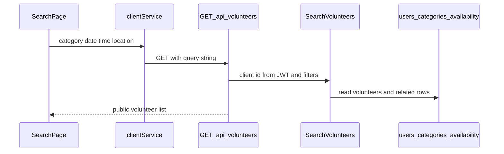

# Volunteer Search

## Recommended feature

**Search volunteers** (`GET /api/volunteers`, query `SearchVolunteers`).

Why this one:

- Already implemented: register, login, logout, profile update, volunteer categories, recurring availability, and rotating file logs.
- [docs/requirements.md](docs/requirements.md) and [docs/features.md](docs/features.md) list client search immediately after the volunteer profile data that search needs. Volunteer details, requests, dashboards, and AI matching come after it.
- Categories, availability, and the formatted address already exist, so search can filter on stored data. It does not need a new table.
- The role table allows search for CLIENT only. A user who also has VOLUNTEER may search. A VOLUNTEER-only user may not.

Actor: CLIENT, including a user with both roles.

## Separate search page

Search is its own page, the same way login, registration, and profile are separate screens in [frontend/src/App.jsx](frontend/src/App.jsx). The app does not use a router. `view === "search"` renders only `SearchPage`. The profile screen is not mounted at the same time.

[frontend/src/pages/ProfilePage.jsx](frontend/src/pages/ProfilePage.jsx) does not contain the search form, the result list, or a call to `searchVolunteers`. For a user whose saved roles include CLIENT, it shows one control that switches the view to `search`. A VOLUNTEER-only profile does not show that control.

`SearchPage` owns the filters and the results. It has a control that switches the view back to `profile`. Leaving the page does not need to keep the last result list.

## Business rules

Optional query parameters from [docs/api.md](docs/api.md): `category`, `date`, `start_time`, and `location`. All four may be omitted. An empty search returns every volunteer. Filters that are present are combined with AND.

- `category` must be one of the eight allowed category strings. Any other value returns `400`. A volunteer matches when that category is one of their saved categories.
- `date` is `YYYY-MM-DD`. It selects the weekday, with Sunday as the first day, using the same names stored for availability. `start_time` is `HH:MM`. Sending one without the other returns `400`. A volunteer matches when one saved window on that weekday satisfies `window start <= start_time < window end`. That is the same boundary as touching windows: Monday `10:00` matches `09:00–13:00` and does not match `14:00–18:00`. Monday `13:00` matches `13:00–16:00` and does not match `09:00–13:00`.
- `location` is matched against the volunteer's stored formatted address, case-insensitive. `jerusalem` matches an address that contains `Jerusalem`. Blank location is ignored. This slice does not call Google and does not use `check_location_distance` or coordinates.

Only users with the VOLUNTEER role are candidates. A client who is also a volunteer can appear in the results. No rows are changed.

Response `200`:

```json
{
  "volunteers": [
    {
      "id": 12,
      "name": "Example Volunteer",
      "address": "1 Kikar Safra, Jerusalem, Israel",
      "categories": ["Shopping"],
      "about_me": "I enjoy assisting elderly people.",
      "availability": [
        {
          "day_of_week": "MONDAY",
          "start_time": "09:00",
          "end_time": "13:00"
        }
      ]
    }
  ]
}
```

Results are ordered by name, then id. Email, phone, password, Google Place ID, latitude, and longitude are not returned. An empty `volunteers` array is `200`, not `404`.

A missing or invalid token returns `401`. A user without CLIENT returns `403`.



## Classification

- **Query:** `SearchVolunteers`. It reads users, categories, and availability.
- **Command:** none.
- **Database:** no new table and no column change. The query does not call `flush`, `commit`, or `rollback`.
- **Event:** none. A search is not a business state change.

AI matching is out of this slice. The API notes that it may rank candidates later.

## Files

### Create

[backend/app/queries/search_volunteers.py](backend/app/queries/search_volunteers.py)

- Class `SearchVolunteers` with `execute(user_id, filters)`.
- Loads the caller through `UserRepository`. Missing user raises `NotFoundError`. A user without CLIENT raises `ForbiddenError`.
- Validates the four optional filters before reading candidates.
- Imports `ALLOWED_CATEGORIES` from [backend/app/commands/update_volunteer_categories.py](backend/app/commands/update_volunteer_categories.py) so the catalog stays in one place.
- Uses a new `UserRepository.list_volunteers()` plus the existing category and availability list methods. Filtering happens in the query, which is enough for this project's data size.
- Builds the public dictionary above. Availability stays in Sunday-through-Saturday order from the existing repository.

[backend/tests/test_search_volunteers.py](backend/tests/test_search_volunteers.py)

- Registers volunteers with the existing place-data helper, assigns categories and availability through the API, then searches as a client.

[frontend/src/services/clientService.js](frontend/src/services/clientService.js)

- `searchVolunteers(filters)` calls `apiRequest` with `GET /api/volunteers` and a query string containing only the filters the user filled in.
- The search page does not call `fetch` or read the token. `apiRequest` already attaches the bearer token.

[frontend/src/pages/SearchPage.jsx](frontend/src/pages/SearchPage.jsx)

- This is the only screen that renders the search form and the volunteer results.
- Fields for category, date, start time, and location. The category dropdown uses `ALLOWED_CATEGORIES` from [frontend/src/services/volunteerService.js](frontend/src/services/volunteerService.js).
- Shows the returned name, address, categories, about text, and availability, plus an empty-state message.
- A back control calls `onShowProfile`.
- A `401` from a revoked token calls `onLoggedOut`.

### Modify

[backend/app/persistence/user_repository.py](backend/app/persistence/user_repository.py)

- Add `list_volunteers()` to return users with `is_volunteer` true, ordered by name, then id. No other repository writes.

[backend/app/routes/volunteers.py](backend/app/routes/volunteers.py)

- Add thin `GET ""` for `/api/volunteers`. Read `category`, `date`, `start_time`, and `location` from `request.args`, pass the JWT user id to `SearchVolunteers`, and return JSON `200`.
- The route does not filter, check the client role, or touch the database. Existing `/me/categories` and `/me/availability` routes stay as they are.

[backend/app/queries/__init__.py](backend/app/queries/__init__.py)

- Export `SearchVolunteers`.

[frontend/src/App.jsx](frontend/src/App.jsx)

- Add `view === "search"`, rendered instead of the profile, login, or register screen.
- Pass `onShowSearch` into `ProfilePage` and `onShowProfile` into `SearchPage`.

[frontend/src/pages/ProfilePage.jsx](frontend/src/pages/ProfilePage.jsx)

- Add a Search volunteers button when the loaded user has CLIENT. The button only calls `onShowSearch`.
- Do not import `SearchPage`, `clientService`, or the category list for a search form. Do not render filters or results on this page.

[docs/api.md](docs/api.md)

- Document the filter rules, the Sunday-based weekday mapping, the half-open time match, the address substring rule, the response shape, `400`, `401`, and `403`.

Do not add volunteer details, request creation, dashboards, or AI matching.

## Implementation steps

1. Add `list_volunteers` to the user repository.
2. Implement `SearchVolunteers` with validation, role check, AND filters, and the public response. Do not write rows or events.
3. Add the thin `GET /api/volunteers` route.
4. Add tests:
   - Shopping plus Monday `10:00` returns the volunteer available `09:00–13:00` and omits the volunteer available `14:00–18:00`.
   - Category alone, location alone (`jerusalem` matches `Jerusalem`), and all filters together.
   - No match returns `200` and `{"volunteers": []}`.
   - A bad category, a bad date, a bad time, or only one of `date` and `start_time` returns `400`.
   - The response has no email, phone, password, place id, latitude, or longitude.
   - A VOLUNTEER-only user receives `403`. A missing token returns `401`.
   - Repeating the search does not add a domain event.
5. Add `clientService.js` and `SearchPage.jsx`. Wire it as its own app view. The profile page only links there when the user is a client.
6. Document the rules in [docs/api.md](docs/api.md).
7. Run the search tests. Then verify in the browser: log in as a client, open the search page and confirm the profile form is gone, search by category and a time that only one volunteer can cover, go back to the profile, and confirm a volunteer-only account has no search link.

Nothing will be implemented until you approve this plan.
